# Ledger – gnome body shrink, checked by eye (Oct 28, 2026)

Job from Forge (Ken OK'd, Oct 28 ~21:05: "shrink the gnome textures, but make sure it doesn't mess up the textures"; studio decision gnome-shrink = Yes). Done in my own Chrome tab. Game branch not touched, no round started, nothing live, nothing deleted.

## Result in one line
All 13 gnome bodies are remade and checked side by side: **10 at 512 px, 3 at 768 px** (Clockwork Beetle, Great Steam Golem, Gnome Tinker looked noticeably softer at 512). But **with both rigged models the game ends at 96.69 MB – over 95 MB.** I stopped there as asked; options below.

## 1. What I made
- Files: `factory-design/design/models/round27-shrunk/<card>-char.glb` (same 13 names as before, so the Round 27 brief's list still points at them) + new `README.md` with the table.
- Started from the game's own `char.glb` files (factory/issue-8; git hash of every one checked = the Studio's `models/<card>-oct25.glb.txt`).
- Textures only: Lanczos resize; JPEG re-saved with the **original's own quantisation tables** and 4:2:0 (same quality), PNG stays PNG; RGB, no alpha in any of them, no colour profile in the originals (sRGB, unchanged). The beetle is the only one with normal + metal/rough maps: all three maps go to the same size (768), and the normal map is re-normalised after resizing.
- Geometry, UVs, bones, skin weights, clips: unchanged. Checked in my box: the glTF JSON is identical apart from byte offsets/lengths of the pictures, and every non-picture byte range (incl. the meshopt-compressed mesh data) is byte-identical to the original. `KHR_texture_transform` values unchanged.
- The first gnome set (all 512 px, made Oct 28 morning) is moved to `round27-shrunk/_discontinued/gnome-bodies-oct28-first/`, not deleted.

## 2. "Doesn't mess up the textures" – the check
For each gnome I rendered the old (game, 1024 px) and new files with three.js r170 in Chrome, same camera, same light, idle pose at t = 0: **front**, a **close-up of the head/face** and a **close-up of the body and hands**. The close-ups are ~3× bigger than the gnome ever appears on the board.

What I saw:
- **Front view: no visible difference** on any gnome.
- **No seams, no misplaced texture, no colour change** on any of them. Average colour of every picture moved by less than 0.4 of 255 (the beetle's metal/rough "R" channel 1.5, which the game doesn't use; its normal map's blue went up 2.8 because the normals are re-normalised – that is correct).
- **Close-ups at 512 px are a little softer** (small belt studs, eyelashes, hat runes). Fine for 10 gnomes.
- **Noticeably worse at 512 → kept at 768:**
  - Clockwork Beetle – the eye emblem on its flag and the panel detail went blurry (it also loses its normal-map detail). At 768 it looks like the original.
  - Great Steam Golem – the eye emblems on its banners went blurry. At 768 they're sharp again.
  - Gnome Tinker – face and belt went smeary in close-up. At 768 it's clean.

Measured difference in the renders (mean pixel difference out of 255, close-ups): 512 px gnomes 7.8–11.8; at 768 px Tinker 7.1–7.5, Golem 7.1–7.5; Beetle at 512 was 15.5–16.5.

Pictures (top row = game now, then 512, then 768 where tried):
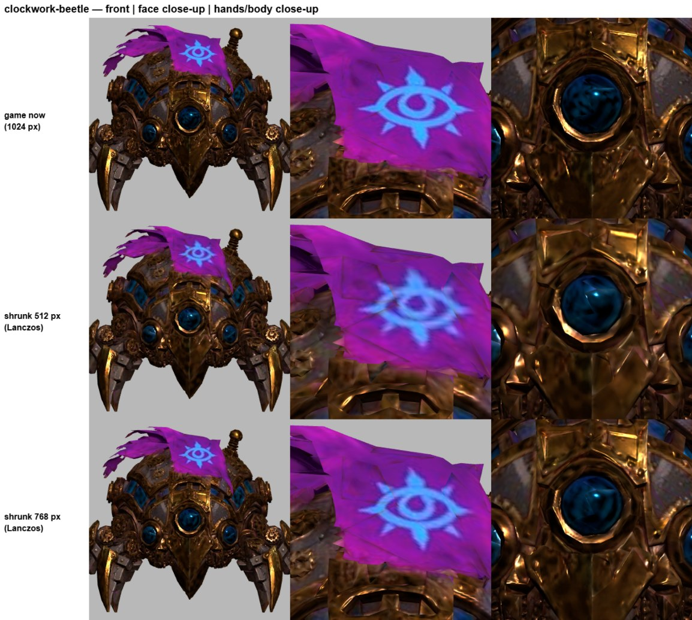
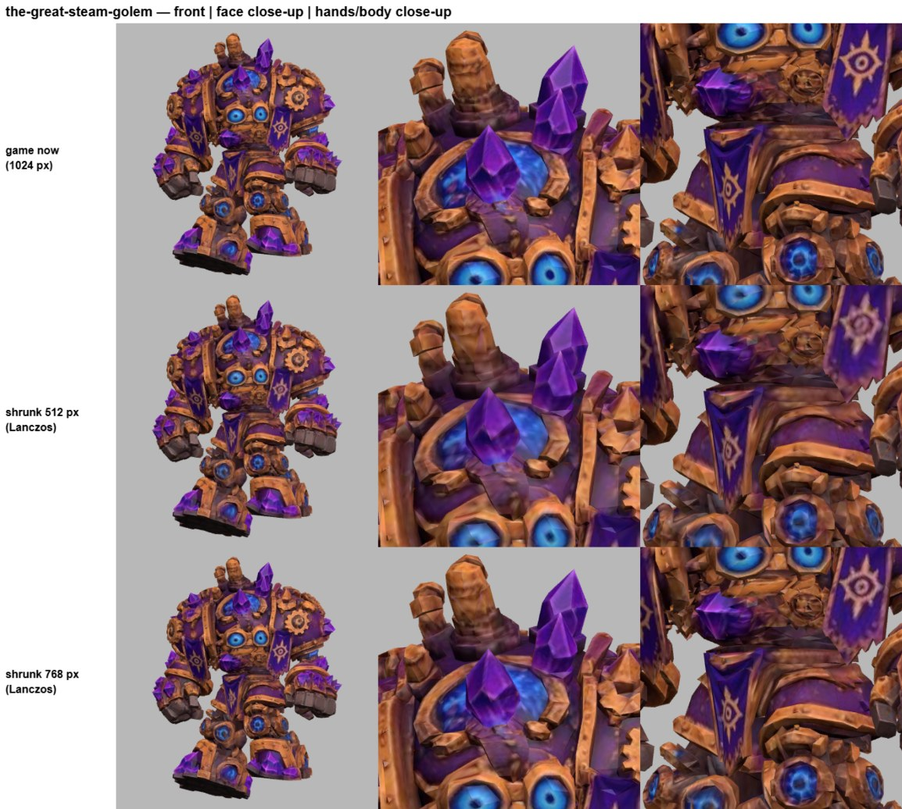
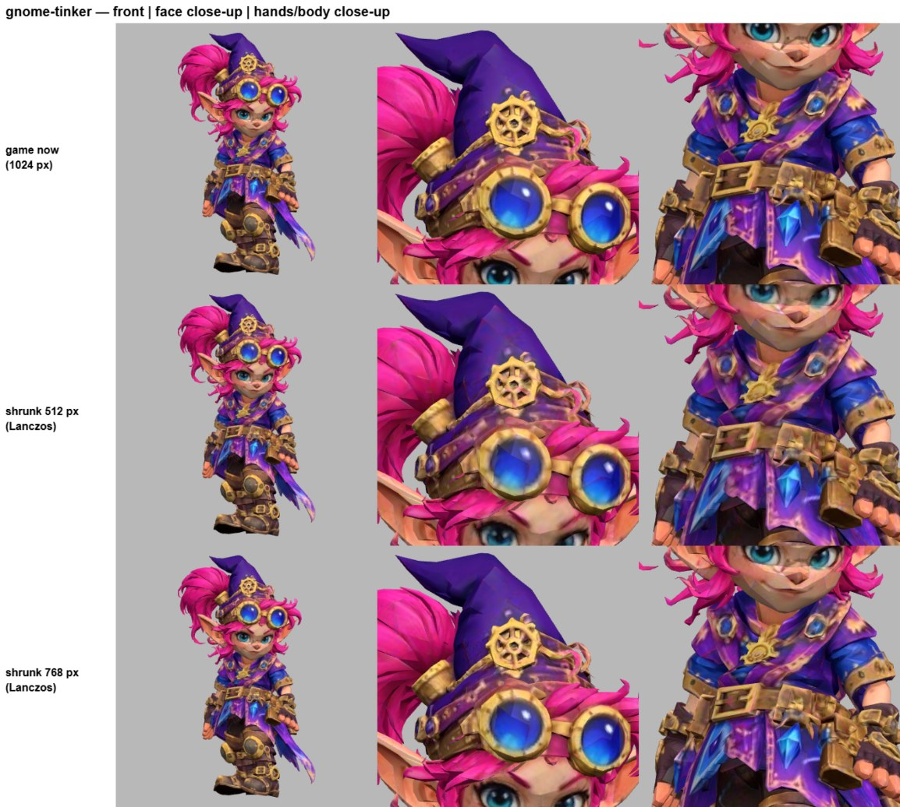
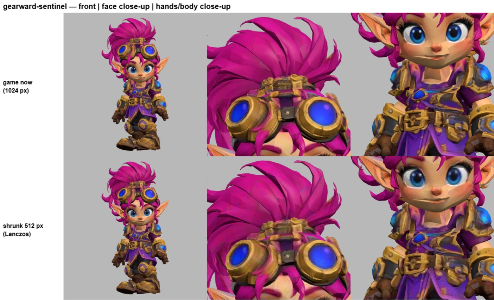
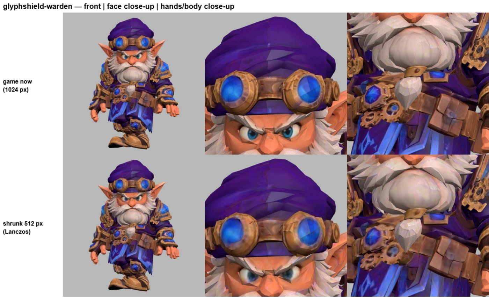
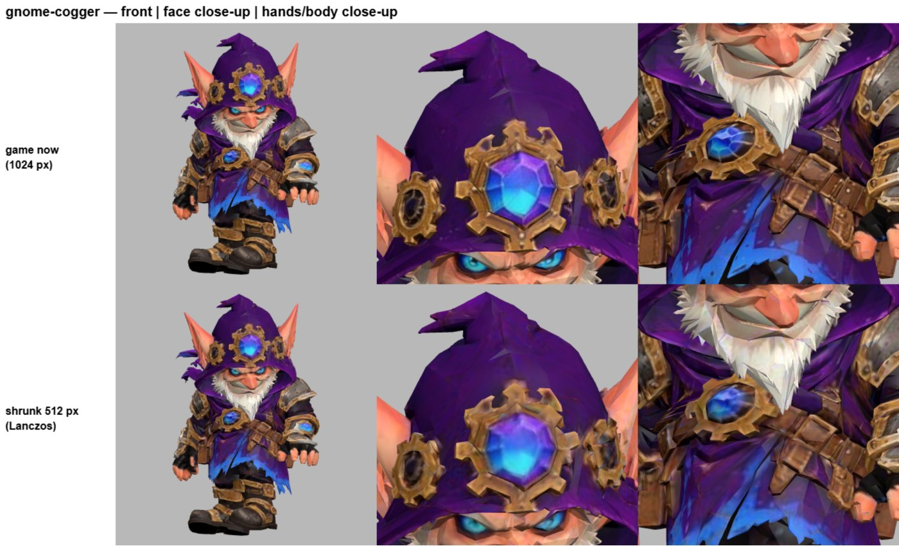
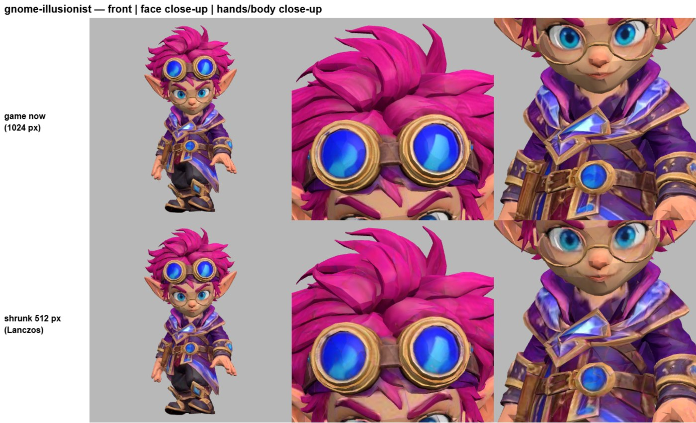
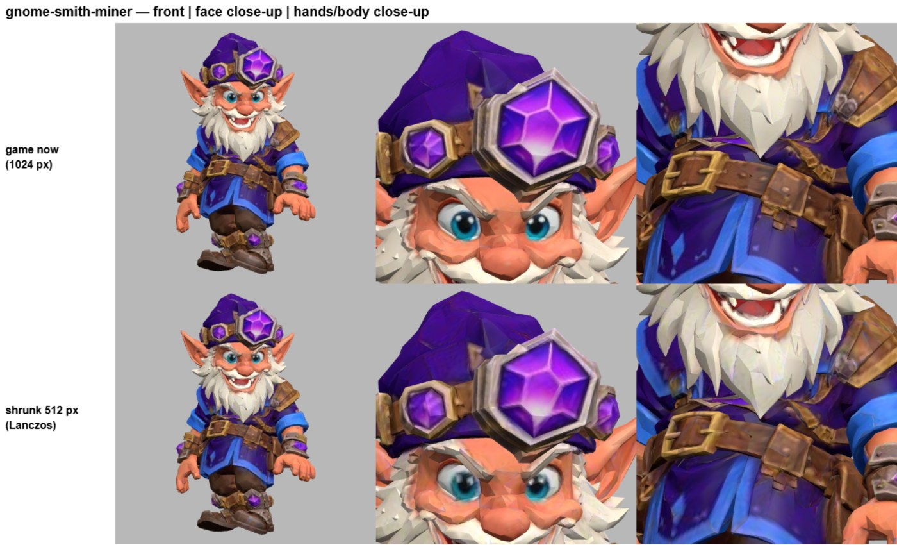
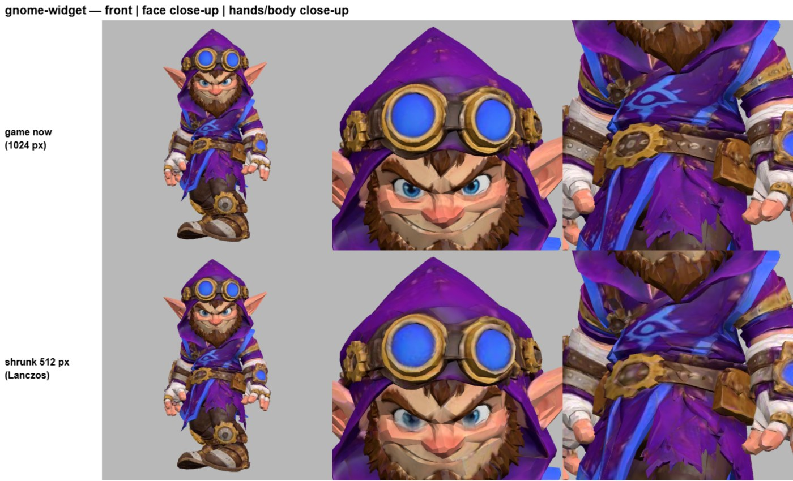
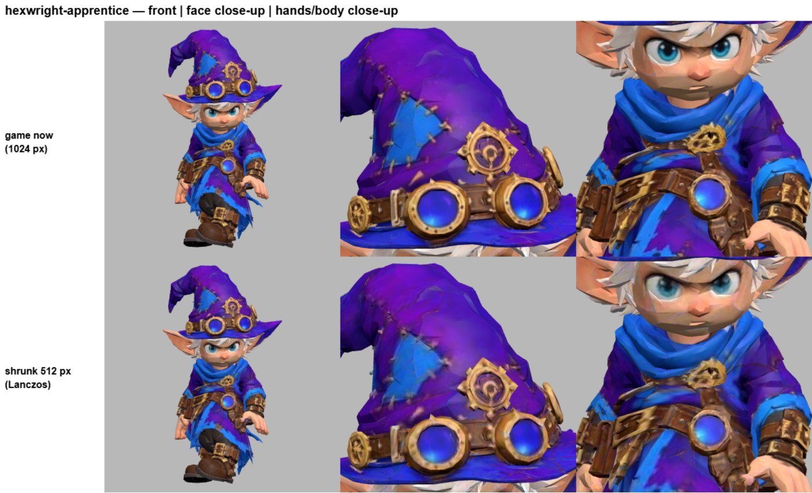
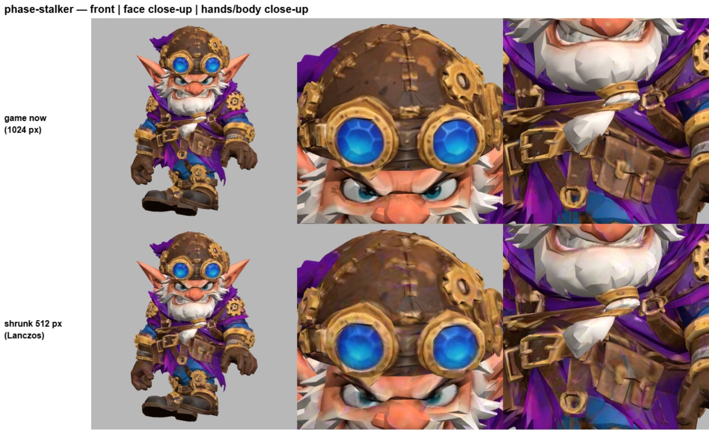
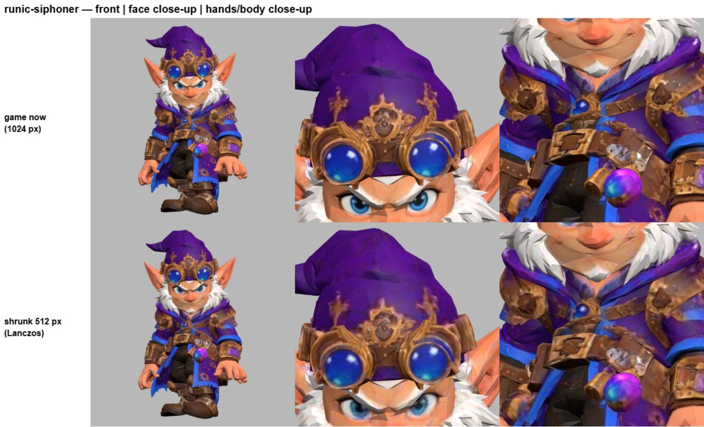
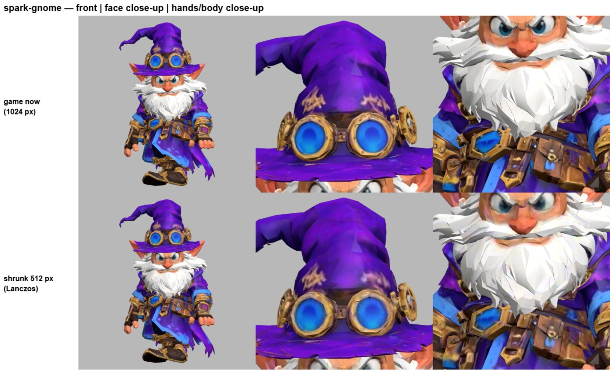

| Gnome | Size used | Old bytes | New bytes | Saves |
|---|---|---|---|---|
| clockwork-beetle | 768 | 3,242,480 | 2,092,496 | 1,149,984 |
| gearward-sentinel | 512 | 951,772 | 748,516 | 203,256 |
| glyphshield-warden | 512 | 1,019,184 | 788,848 | 230,336 |
| gnome-cogger | 512 | 1,053,268 | 810,336 | 242,932 |
| gnome-illusionist | 512 | 889,316 | 681,684 | 207,632 |
| gnome-smith-miner | 512 | 950,228 | 736,668 | 213,560 |
| gnome-tinker | 768 | 1,005,104 | 870,484 | 134,620 |
| gnome-widget | 512 | 977,620 | 751,568 | 226,052 |
| hexwright-apprentice | 512 | 979,220 | 760,792 | 218,428 |
| phase-stalker | 512 | 1,057,264 | 834,792 | 222,472 |
| runic-siphoner | 512 | 986,524 | 760,084 | 226,440 |
| spark-gnome | 512 | 1,043,048 | 801,856 | 241,192 |
| the-great-steam-golem | 768 | 1,091,764 | 946,864 | 144,900 |
| **Total** | | 15,246,792 | 11,584,988 | **3,661,804** |

## 3. Round 27 size (measured, factory/issue-8 `projects/oreheart-8/public/`, 1 MB = 1,000,000 bytes)

| Step | MB |
|---|---|
| Game files now (Round 26 parts are in) | 93.58 |
| + 15 parts (item A) | 98.39 |
| − 15 dwarf bodies | 95.36 |
| − 13 gnome bodies (this job) | 91.70 |
| + Anvilsworn Miner rigged (2.60) + Borgo rigged (2.38) | **96.69** |
| Section H (heights) | +0 (code only) |

- **96.69 MB: over 95 MB** (under 100). Even with all 13 gnomes at 512 it would be 95.61 MB – still over.
- Note: my earlier "95.38 MB now" was out of date; today's game files are 93.58 MB. The builder measures the built `dist/` (AC399), which also has the code bundle, so the real number will be a little higher than these file sums.
- Not counted: any Round 27 D moves Ken approves (new char.glb files), and accessories for the two rigged models (pickaxe/hammer, sceptre/throne) – neither has a saved Studio setup yet.

### What else could shrink (textures only; nothing done – needs Ken)
| Option | Saves (about) | Size after (MB) | Note |
|---|---|---|---|
| a. 12 goblin bodies still at 1024 px (bomber, grunt, scrapper, slinger, sneak, junk-shaman, rotgut-grenadier, skullbasher, wolf-rider, blastrat, shard-guzzler, big-boss troll) → 512 | 2.6 | ≈ 94.1 | estimate from the gnome results; same eye check needed. If Round 27 D brings new goblin char.glb files, those need the same shrink. |
| b. Crystal node (mines), 3 maps 1024 → 512 | 0.45 | | estimate |
| c. Grubnak's throne, 3 maps 768 → 512 | 0.3 | | estimate |
| d. Rigged Miner + Borgo: normal and metal/rough maps 512 → 256 (colour stays 512) | 0.15 | | estimate; small |
| e. Beetle, Golem, Tinker at 512 anyway | 1.08 | 95.61 | not enough alone, and they look softer (pictures above) |
| f. Only one rigged model in Round 27 | 2.4–2.6 | ≈ 94.1–94.3 | Ken wants both, so last resort |

My suggestion: **a** (goblins to 512, with the same side-by-side check) gets to about 94.1 MB with both rigged models and keeps every gnome looking right. Adding **b** gives about 0.5 MB more room.

## 4. Notes from Ken (via Forge)
- **Bare Knuckle Lunatic keeps his current model** (no v5).
- **Ken wants both rigged models in Round 27** (Anvilsworn Miner `dwarf-smith-miner`, Thane Borgo Gravelgrim `cmd-borgo`; Clay's `factory-design/design/models/*-rig-oct28.glb`). They're in the Studio's Model Editor (`models/anvilsworn-miner-rig-oct28.glb.txt`, `models/borgo-rig-oct28.glb.txt`; same bytes as main, git hash checked). `library/<card>.src` stays unchanged until Ken approves them in the Studio – "add if approved".

### Doc updates – held (stopped at step 3)
Because the total is over 95 MB, I did **not** yet change `editor-setups-2026-10-28b.md` or the Round 27 brief's file list (pointing the builder at both rigged models now would make the round fail AC399). Ready to do as soon as Ken picks a size option:
- Brief C: gnome list stays the same file names (they already point at the new files); change "1024 → 512 px" to "512 px, or 768 px for clockwork-beetle, the-great-steam-golem, gnome-tinker"; replace the size lines with the table above.
- Brief + editor-setups: add "Rigged models (add if approved)": `anvilsworn-miner-rig-oct28.glb` → `public/models/creatures/dwarf-smith-miner/char.glb`, `borgo-rig-oct28.glb` → commander Borgo's model, only if Ken has approved them in the Studio when the round starts; they have no saved Studio setup (no heights/look yet), so Ken saves a setup first (Handbook: no guessing).
- Brief D: remove the Bare Knuckle Lunatic v5 row (Ken: keeps current model).
- The Round 27 builder's file copy stays byte-for-byte; after the round, the Studio's Model Editor bodies must get the same files (Wright publishes, I update `library`).

## Editors
- The Studio still has the full 1024 px bodies; nothing changes in Ken's setups (textures don't move anything). Studio files get swapped to the game files after the round (Wright), as the brief says.
