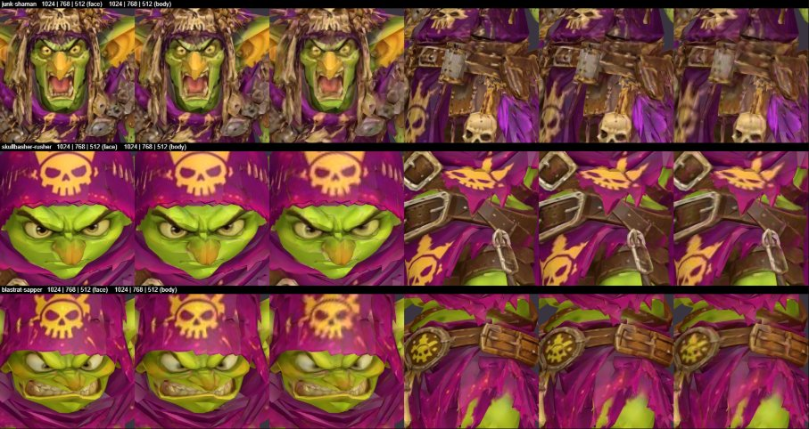
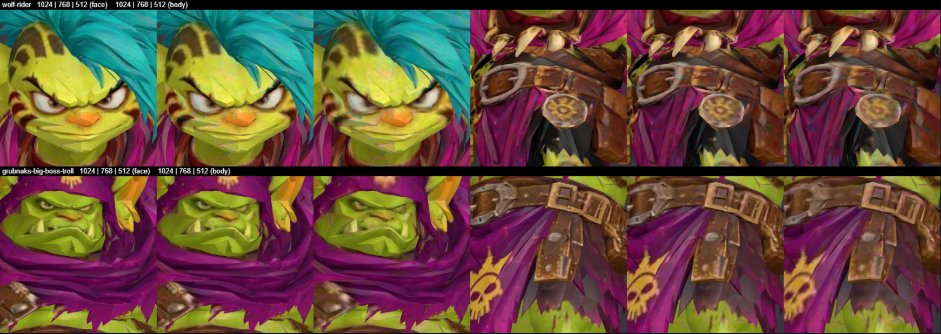
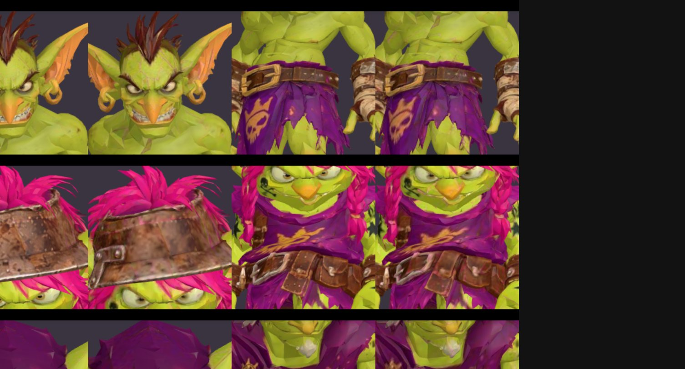
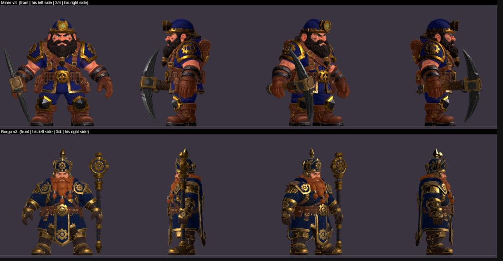
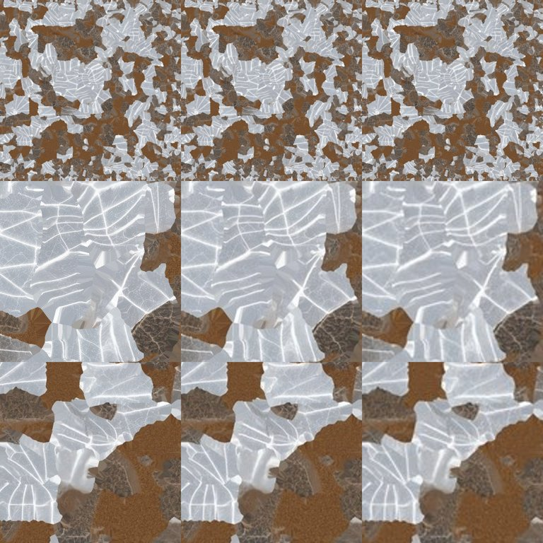
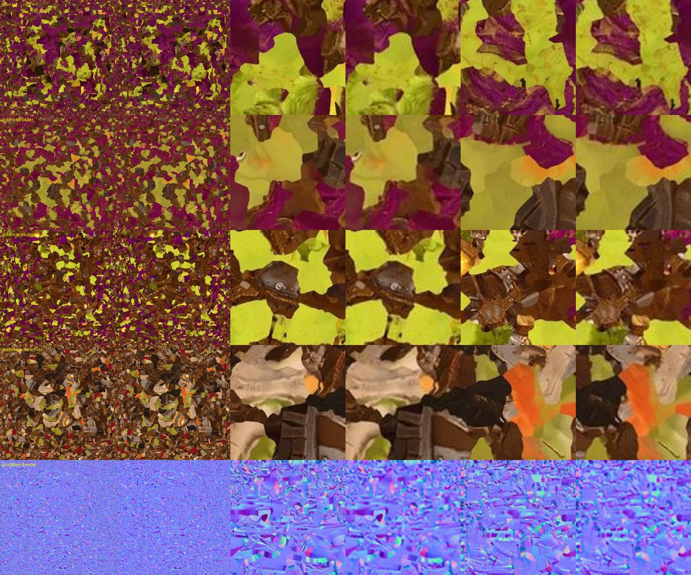

# Ledger – Round 27 ready-up (Oct 28, 2026)

Job from Forge (Ken's answers in Forge's chat, Oct 28 ~22:00). Done in my own Chrome tab. Game branch not touched, no round started, nothing live, nothing deleted.

## Result in one line
Everything Ken asked for is done, but **Round 27 measures 95.15 MB – 0.15 MB over 95.** One more small texture shrink (option A, files ready) brings it to **94.55 MB**. Asked Ken in Oreheart Studio: `decisions/r27-size-option-a`. **Round 27 should not start until he answers.**

## (a) 12 goblin bodies – textures shrunk, checked by eye
- Started from the game's own `char.glb` files (factory/issue-8, git hash of each checked). 8 are the Studio's v4 files; blastrat-sapper, shard-guzzler, wolf-rider and the troll are older game files (got them from GitHub through Ken's Chrome).
- Same method as the gnomes: Lanczos, original JPEG quantisation tables and 4:2:0. Every non-picture byte and the glTF JSON (apart from offsets) identical to the original.
- Side-by-side in three.js r170 (idle t=0, same camera/light; face and body close-ups ~5× bigger than on the board):
  - **512 px fine:** goblin-bomber, goblin-grunt, goblin-scrapper, goblin-slinger, goblin-sneak, rotgut-grenadier, shard-guzzler, grubnaks-big-boss-troll (a little softer up close only).
  - **Noticeably worse at 512 → 768 px:** junk-shaman (busy trinkets, face), skullbasher-rusher and blastrat-sapper (skull emblems blur), wolf-rider (faint seams on the face, badge). At 768 they look like the original.
- Saves 2,154,324 bytes. Files: `factory-design/design/models/round27-shrunk/<card>-char.glb` (README updated).

## (b) Both rigged models approved
- `characters/cmd-borgo.steps.model` = approved, note "Ken, Oct 28, in Forge's chat: put both rigged models in" (pinned write, kenNote untouched).
- `characters/dwarf-smith-miner.steps.model` was **already approved by Ken himself** (18:35 UTC, in the Studio) – left as Ken set it.
- `library/<card>.src` already pointed at `anvilsworn-miner-rig-oct28` / `borgo-rig-oct28` (Wright, earlier) – checked, nothing to change. (Their old `pendingModel.status` still says "waiting for Ken" – harmless leftover, not touched.)

## (c) Studio setups for the Anvilsworn Miner and Borgo – saved with "Save as default look"
- Height: **body scale 1** = 1.0 board squares, same as all 15 of Ken's dwarf setups (open question `dwarf-heights` – Ken may still resize dwarves).
- **Anvilsworn Miner:** pickaxe (`stonebreaker-pickaxe`) on **RightHand**, held the way Ken's Gemdrunk Deepdelver holds his pickaxe (same angle to the body, grip moved onto the hand, sized to the model sheet ≈ 0.69 squares tall). No hammer: the card art shows only the pickaxe. Values: pos [-6.164, 15.149, 10.053], rot [-66.649, 52.929, 128.399], scale 38.
- **Borgo:** gear sceptre (`borgo-sceptre`) upright in his **LeftHand**, as in his card art, foot on the ground, top at crown height. Values: pos [-2.502, -5.086, 3.574], rot [8.993, 35.932, 157.604], scale 50. **No throne** – Ken's commander setup (Grubnak) doesn't use one.
- How: built the numbers in three.js, rendered front/side/3-4/back, then wrote them as named saves (`modelSetups/ledger-oct28-anvilsworn-miner-setup`, `…-borgo-setup`), **loaded them in the Studio's Model Editor** with the card picked, and pressed **Save as default look**. Checked the saved `library` docs: exact numbers, setupSummary Miner 1.02 / Borgo 1.00 squares, new look/final files.
- `steps.editor` = **waiting** for both: "Forge/Ledger made this setup for you to check; change anything you like." (+ short notes on pickaxe/sceptre/throne/heights).
- Heights for the game: idle-0 heights 0.9432 / 1.0005 → `LOOKS.height` 0.943 (Miner) and 1.001 (Borgo).

## (d) Size (measured from the factory/issue-8 file list, all of `public/`, 1 MB = 1,000,000 bytes)

| Step | Bytes | MB |
|---|---|---|
| Game files now | 93,580,935 | 93.58 |
| + 15 parts (A) | +4,808,392 | 98.39 |
| − 15 dwarf bodies | −3,025,808 | 95.36 |
| − 13 gnome bodies | −3,661,804 | 91.70 |
| + 2 rigged models | +4,987,688 | 96.69 |
| − 12 goblin bodies (this job) | −2,154,324 | 94.54 |
| + pickaxe + sceptre (parts, 256 px textures) | +1,073,824 | 95.61 |
| − crystal node maps 1024 → 512 (option b, done) | −455,944 | **95.15** |
| − option A (needs Ken) | −599,828 | **94.55** |

- The pickaxe and sceptre weren't in my earlier "≈ 94.1 MB" estimate (they had no setup then), and 4 goblins needed 768 px – that's why it's still over.
- **Option A** (files ready in `round27-shrunk/option-a-needs-ken/`): 5 goblin pictures 768 → 512 px – Shiv Rat, Boneknocker, Goblin Miner, Scrapsmith Miner bodies and Grubnak's throne. Checked on the pictures themselves (small step, slight softening); I'll do the full render check if Ken says yes.
- Other ways if Ken says no: put the 4 softer goblins at 512 too (−0.40 MB), or leave the pickaxe/sceptre out (−1.07 MB).

## (e) Docs updated on main
- `oreheart-round-27-brief.md`: C (512 / 768 lists for gnomes and goblins, crystal node, option A only if Ken says yes, new size table and "not ready until Ken answers"); new section **R. Rigged models** (both, files, clips, PARTS, LOOKS, AC414–416); order C, A, B, R, H, D, E; D without the Bare Knuckle Lunatic v5 row (keeps current model).
- `editor-setups-2026-10-28b.md` + `.json`: "Rigged models" section with both setups and heights; 2 rows in the heights table and 2 `LOOKS` lines; body-texture section and SIZE replaced (the old 92.43 MB / gnome-first-set numbers are gone). JSON: `cards` + `heightsForGame` for both (re-written with the same 1-space format; a few `1.0` became `1`, same values).
- `round27-shrunk/README.md`: goblins, crystal node, option A, new size table.
- New parts: `parts/stonebreaker-pickaxe.glb`, `parts/borgo-sceptre.glb` (textures 512 → 256, all other bytes identical).

## Editors
- Studio: both new setups saved (Ken to check). The Studio keeps full-size bodies; after the round, Wright swaps the Studio files to the shrunk game files as the brief says.
- Decision asked: `decisions/r27-size-option-a`.
